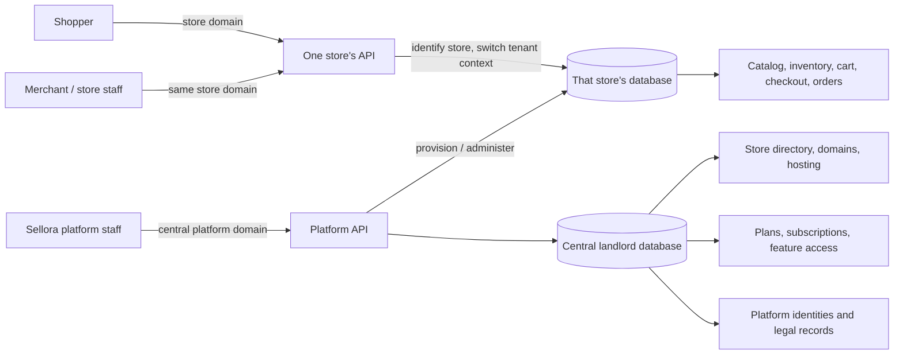

# Sellora documentation

Start here if you are new to the project.

## What Sellora is

Sellora is an e-commerce platform for merchants anywhere in the world. A
merchant signs up, gets their own store with its own address, and sells
online. This repository is the Sellora API: the platform admin app, merchant
dashboards, storefronts and the driver app are separate frontends that use
it.

One platform hosts many independent stores. Two words describe its two
sides:

- **Landlord** is the central platform. It knows which stores exist, where
  their databases are, what plans they are on, and which platform staff run
  the service.
- **Tenant** is one merchant's store. Its products, customers, orders and
  staff belong to that store alone, in that store's own database.

The central database is not a shared pool of every store's sales. It keeps
what is needed to find and manage stores. When a request arrives on a
store's domain, the application finds that store in the central directory,
then switches into the store's own database before handling the request.

## The three zones of the code

| Zone | Where | What lives there |
| --- | --- | --- |
| Core | `app/` | What every store gets, the landlord side, and shared building blocks. Core business areas are called **domains** (Catalog, Orders, Payments…). |
| Modules | `modules/` | Business features a store gets only on plans that include them, such as Restaurant or Wallet. None is built yet. |
| Integrations | `integrations/` | Connections to outside services, also by plan. Built so far: Paystack (payments) and Open Exchange Rates (market exchange rates for the platform). |

"Module" only ever means a plan-gated feature in `modules/`.

## The four account types

Each kind of person signs in separately, with their own accounts and
tokens; a token for one never works for another.

| Who | Lives in | How they sign in |
| --- | --- | --- |
| **Platform admins**: Sellora's own team | Central database | Email and password, with two-factor authentication always on. The first one is created from the command line; later ones join by invitation. |
| **Store staff**: a merchant's owner and team | That store's database | Email and password; the owner can require two-factor authentication. Staff join only by invitation, and roles and permissions decide what each may do. |
| **Customers**: shoppers | That store's database | Email and password, or Google or Apple if the store offers them. An account in one store is separate from an account in another. Guests can also buy, if the store allows it. |
| **Drivers**: a store's own delivery drivers | That store's database | Phone number and PIN, for a driver app. |

## The main flows

1. **A merchant opens a store.** They choose a plan and a subdomain, accept
   the platform's current terms and verify their email. The platform creates
   the store's database in the chosen hosting region and the owner's account,
   then the store opens. See [store tenancy and registration](landlord/tenancy.md).
2. **The merchant sets up.** Store settings (currency, languages, tax mode,
   guest checkout), the team, products and variants, stock, prices and tax
   rates, extra currencies, promotions, shipping zones and methods, and
   payment methods: bank transfer, cash on delivery or Paystack.
3. **A shopper buys.** They browse, fill a cart, and check out. Checkout
   shows a quote that holds for a short time; confirming it reserves the stock
   and promotion uses and creates the order, which keeps a copy of everything
   charged. See [business flows](tenant/business-flows.md).
4. **Payment.** Online payments are confirmed by asking the gateway, never by
   trusting a redirect or a webhook alone; staff record bank transfers and
   cash. An invoice is issued once an order counts as a sale.
5. **Fulfilment.** Staff create shipments, which move from pending to shipped
   and delivered, or to ready for pickup and then handed over. Stock leaves
   the shelf only then. A store with its own drivers gives each delivery to
   a driver, who picks it up, hands it over with proof (and collects any
   cash on delivery) or reports it failed; the buyer can follow it while it
   is on the way. See [Delivery](tenant/delivery.md).
6. **Refunds and cancellations.** Staff refund through the original payment
   method; a refund that reduces a sale gets a credit note. Cancelling an
   unshipped order releases its stock and promotion uses.
7. **Running the platform.** Platform admins manage stores (suspend,
   reactivate, close, restore before purge), plans and per-store feature
   grants, legal documents and the platform team. A closed store's data is
   purged after its retention period; a store can export its data first.
8. **Customer privacy.** Customers can export their data and erase their
   account; financial and tax records are kept for as long as the law
   requires, without the personal details that aren't needed.

## Planned, not built yet

These are in the approved build order (CLAUDE.md section 17) but don't exist
yet:

- **Step 18, Returns:** returns with a refund or an exchange. Today a refund
  doesn't put stock back.
- **Step 19, Storefront:** content pages, menus, banners, SEO, wishlists,
  fetching several products for comparison, related and similar products and
  best sellers.
- **Step 20, Messaging:** one place for messages, email first
  ([Messaging](tenant/messaging.md)). Today each domain sends its own emails.
- **Step 21, Data tools:** import and export, bulk actions and dashboard
  numbers.
- **Phase C, after the shopping flow works:** custom domains, merchant
  billing ([Billing](landlord/billing.md)), Stripe and other gateways, live
  updates, custom fields, and modules.

## Choose a guide

- [Landlord: central platform](landlord/README.md): store registration,
  provisioning, plans, platform staff and legal terms.
- [Tenant: one merchant store](tenant/README.md): a store's settings,
  products, inventory, shoppers and orders.

Developer guides span both sides: [landlord and registration API
testing](landlord/api-testing.md) covers central endpoints, [tenant API
testing](tenant/api-testing.md) covers store-domain endpoints, and
[deployment](deployment.md) explains migrations and the work to run on every
release.

Field-level detail about tables and columns is not written by hand in these
guides; it lives in the database's own column comments.
