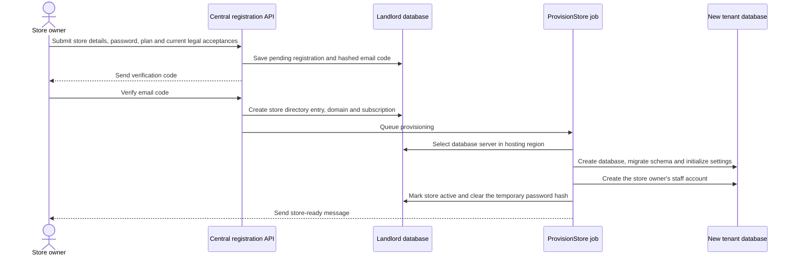

# Landlord: the central Sellora platform

This guide is for understanding the platform that hosts stores. In tenancy
terms, the **landlord** is Sellora; each merchant's store is a **tenant**.
The landlord does not hold the stores' product catalogs, carts or orders.
Those records live in each store's own database.

## What belongs to the landlord?

The central (landlord) database contains information needed to operate the
platform:

| Information | Examples |
| --- | --- |
| Store directory | Store identity, status, domain, hosting region and database server. |
| Registration | Pending sign-ups, verification-code hashes and legal acceptances. |
| Plans and access | Plans, plan features/limits, each store's subscription, individual feature grants and limit overrides. |
| Platform people | Platform administrators, their roles and permissions. |
| Platform policies | Legal document versions and records showing which version was accepted. |
| Operations | Database server placement, store export/purge coordination, platform-wide webhooks and other platform services. |

The tenant's real catalog, customers, staff, inventory, checkouts, orders and
payments are in the tenant database. A tenant database is separate for each
store; store A does not query store B's product or customer tables.

## How a store is created

The landlord owns the store's lifecycle from sign-up through database setup:



1. `StartStoreRegistration` checks that registration is open, the requested
   plan is available, the required legal versions are accepted, the hosting
   region has capacity, and the email/subdomain limits allow the request.
   It stores a pending registration and sends an email code; it does not
   create a tenant database yet.
2. `RegisterStore` verifies that code. It creates the central store record
   and domain, applies country defaults, starts the first subscription, and
   queues `ProvisionStore`.
3. `ProvisionStore` places the database on a server in the selected region,
   creates and migrates the tenant database, initializes the store settings,
   creates the owner's staff account, then marks the store active. The
   store serves no tenant requests while it is being provisioned.
4. Provisioning retries safely. If all attempts fail, the store is marked
   `provisioning_failed`; a platform administrator can inspect the failure
   and retry setup.

This separation keeps the registration request short and prevents a partially
set-up store from being treated as open for business.

## A store's platform-side lifecycle

The central `tenants` record is the directory/control record, not the store's
commerce database. It tracks the store's public identity, domain, hosting
region, database placement and lifecycle status.

```text
provisioning ──success──> active ──platform suspension──> suspended
     │                       │                               │
     └─all retries fail─> provisioning_failed               └─reactivate─> active
                              │
                              └──close──> closed ──restore before purge──> prior status
                                              └──retention expires──> purging ──> purged
```

- **Active:** tenant domains serve store requests.
- **Suspended:** a platform administrator has suspended the store. Data is
  retained; the platform can reactivate it. This is distinct from the
  subscription's own status.
- **Closed:** the store stops serving requests and tenant sessions are
  revoked. Data is retained until its purge date, and it can be restored
  before purge. Restoring a previously suspended store returns it to
  suspended, not active.
- **Purging/purged:** the irreversible data-removal process. The platform
  keeps a minimal central record, but the store database, files, domains and
  owner contact details are removed.

The merchant may also request closure. Closure and subscription cancellation
are separate business events; one should not be assumed to perform the
other.

## The request boundary

Platform routes use the central domain and the platform-admin identity.
Registration routes also run centrally, before a store database exists.
Tenant routes use the store's domain. The tenancy middleware resolves the
domain using the central store directory, bootstraps that store's database
and tenant-aware services, then the request is handled in the store context.
When the request ends, the application returns to the central context.

Reference geography data is available centrally and on store domains. It is
read-only from tenant features; the stores do not each manage their own copy
of the global country/currency/timezone reference data.

## Landlord guides

- [Store tenancy and registration](tenancy.md)
- [Plans, subscriptions and access](plans-and-subscriptions.md)
- [Platform identity](identity.md)
- [Legal documents and acceptance](legal.md)
- [Landlord integrations](integrations.md)
- [Landlord billing](billing.md)
- [Landlord and registration API testing](api-testing.md)
- [Deployment](../deployment.md)

## Current boundary

The [landlord Billing area](billing.md) currently has no billing
implementation. Plans and subscription records exist, but subscription
charges or invoices are not processed by a landlord billing workflow. The
tenant's order Payments domain is a separate thing.
