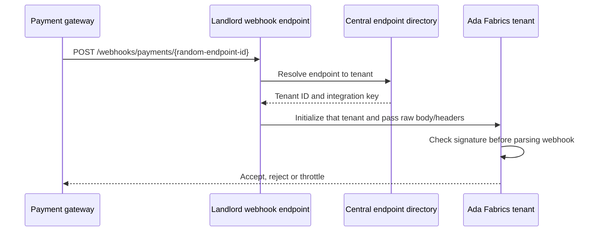

# Landlord integration entry points

Some integrations are configured by a store but need a public URL on the
central platform domain. The landlord integration area provides the shared
entry point and routes the request to the correct tenant. It does not own
that store's payment or order records.

## Example: a store payment webhook

Suppose Ada Fabrics connects a payment gateway. The tenant Payments
configuration owns Ada's connection and credentials. The platform creates a
random webhook endpoint ID and keeps a central mapping from that ID to the
tenant and integration name.

The central controller does not trust the webhook body or decide that an
order is paid. It uses the unguessable endpoint ID to find the tenant,
initializes that tenant, then hands the raw body and headers to the tenant's
payment-webhook implementation. That implementation verifies the signature
with the store's credentials before parsing or acting on the event. Payment
status is checked with the gateway through the tenant [Payments](../tenant/payments.md)
workflow.

Stores that are closed or purged do not receive new webhook work. A suspended
store can still receive callbacks for payments already in progress. Unknown
endpoint IDs are rate-limited separately so guesses or stale URLs do not
slow down valid webhook delivery.

The central endpoint record only routes: the random endpoint ID, the store
and the integration. It holds no gateway credentials and no copy of a
store's payment. Which mode (test or live) an endpoint is for is kept with
the store's gateway connection, in the store's database.

See [Payment gateway integrations](../tenant/payment-gateways.md) for the
store-side adapter contract and [Landlord overview](README.md) for the
central/tenant boundary.
