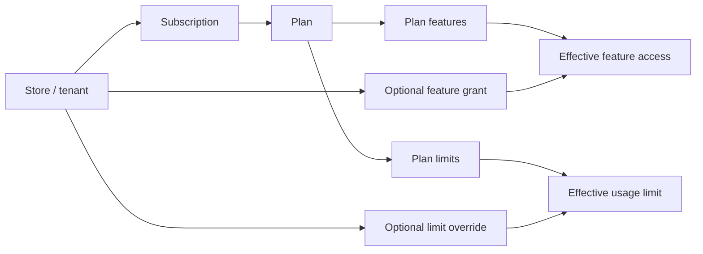

# Plans, subscriptions and store access

Plans describe what a store is entitled to use. The landlord keeps those
entitlements centrally so a store's database does not control its own plan.
This area is separate from a merchant buying products in their tenant store.

## The three pieces

1. A **plan** is a named package that the platform makes available.
2. A **subscription** assigns one plan and a status to one store.
3. **Entitlements** are the enabled modules/integrations and usage limits
   resolved from the plan, with any allowed per-store exceptions.

## What the platform keeps

Field-level detail is in the database's own column comments. In outline:

- A plan has a code and a name, and says whether it is active, public and
  open for selection. It lists the modules and integrations it includes and
  its usage limits, such as how many products or staff accounts.
- Each store has one subscription: its plan, its status and, during a trial,
  when the trial ends.
- A platform admin can grant one store a module or integration its plan
  lacks, with a reason and an optional expiry, or override one of its limits,
  without changing the plan for every store. Each store's resulting feature
  states are kept centrally too.

## What happens when a plan changes?

`StartSubscription` gives a new store its first active or trial subscription.
`ChangeSubscriptionPlan` updates the selected plan through the landlord
workflow. The effective feature/limit state is refreshed so tenant middleware
and actions use the new entitlement. A platform administrator can separately
grant a feature or set a limit override for an individual store. Expiring or
revoking such an exception does not rewrite the shared plan.

Feature access and feature data are different concerns. When a feature is no
longer included, its access can be locked while its existing tenant data
remains readable; a plan change should not be described as silently deleting
the store's data.

## Subscription statuses

| Status | Meaning |
| --- | --- |
| `trialing` | Store is trying the plan until the configured trial end. |
| `active` | Subscription is in good standing. |
| `past_due` | Payment is overdue; access remains during the configured grace period. |
| `suspended` | Subscription access has been suspended; data is retained. |
| `cancelled` | Merchant cancelled; access continues until the paid period ends. |

**Planned (Phase C, merchant billing):** today a subscription is only
started (trialing or active) and moved to another plan. Nothing yet moves
one to past due, suspended or cancelled, because merchants aren't charged
yet; those statuses are defined for when billing is built.

Do not confuse the subscription's status with the store's status. The subscription
describes plan/payment standing; the tenant status describes whether the
platform has provisioned, opened, suspended, closed or purged the store.

## Billing is a separate implementation question

The landlord Billing folder is currently empty apart from its placeholder.
The repository has plan and subscription state, but there is not yet a
landlord billing flow documented here for charging merchants, collecting
subscription invoices or reconciling those payments. Tenant Payments handles
orders sold by merchants and is not the landlord's subscription billing
system.

See [Landlord overview](README.md) for where these records live and
[Tenant overview](../tenant/README.md) for the store-side features they gate.
