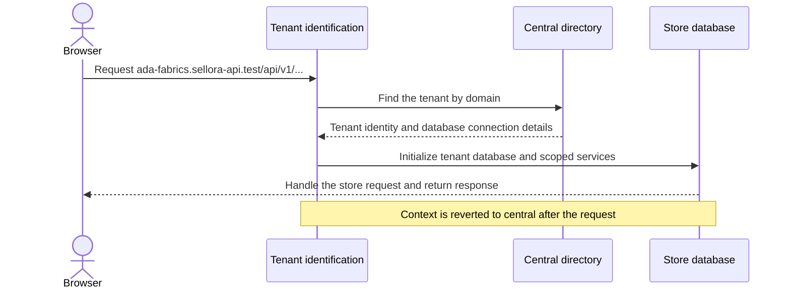

# Store tenancy and registration

This guide explains how a merchant's store becomes a tenant, how requests
reach the right store database, and what the platform does when a store is
suspended or closed.

## The key words

- A **tenant** is one merchant's store, including its own store data and
  settings.
- The **landlord** is the central Sellora platform that keeps the directory
  of tenants and manages their lifecycle.
- A **domain** is an address that points to a tenant. The platform finds
  the tenant from the requested domain.
- A **tenant database** is that store's isolated database. In the current
  configuration, each tenant gets a database; it is not a `tenant_id` column
  used to mix every store's rows into one commerce database.

## Central directory records

The central database keeps what it needs to find and run each store.
Field-level detail is in the database's own column comments. In outline:

- One record per store: its public identity, name, status, owner contact,
  country defaults, hosting region, database server and lifecycle dates.
- The domains and subdomains that lead to a store.
- The pool of database servers, with their regions and capacity, from which
  a new store's database is placed.
- Sign-ups not yet turned into stores: verification attempts and expiry, and
  the password hash needed to create the first owner account, cleared once
  the store is set up.
- Store exports a store asked for, while they are built and downloaded.

Legal acceptance and subscription records are also central, but are explained
in [Legal documents](legal.md) and [Plans and subscriptions](plans-and-subscriptions.md).

The store's central record holds only what the platform needs to locate and
operate it. Its products, customers and orders live in its own database.

## Registration in everyday language

Imagine Ada wants to open **Ada Fabrics** at `ada-fabrics.sellora-api.test`.

1. Ada submits the store name, requested subdomain, owner details, country,
   timezone, hosting region and password, and accepts the legal versions
   currently in force.
2. The central platform checks if the store can be registered, reserves the
   subdomain temporarily, saves a one-time verification-code hash and emails
   the code. At this point there is no tenant database.
3. Ada enters the code. The platform creates the store's central directory
   record and domain, selects the country's default currency/language, starts
   the chosen subscription, and queues database setup.
4. The queued provisioning job creates the database in the selected region,
   runs tenant migrations, initializes store settings and creates Ada's owner
   account in the tenant database.
5. Only after setup succeeds is the store marked active and the ready email
   sent. If setup exhausts its retries, the store is marked failed and a
   platform administrator can retry it after fixing the cause.

## What happens on an ordinary request?

The same application code serves many stores. The request's tenant context
chooses which isolated database and scoped services the code sees. Cache
keys, filesystem storage, queues and Redis are also configured to be
tenant-aware; the exact behavior is wired in the tenancy provider/config.

## Suspension is not closure

- Suspending a store is a reversible platform action. It retains data and
  domain records; reactivation clears the platform suspension only.
- Closing a store stops tenant traffic and signs out store sessions. The
  central record tracks who closed it and a retention/purge date. It may be
  restored before purge.
- Purging deletes the store's data after the retention period. Once purging
  has begun, the store cannot be restored.
- Subscription status is tracked separately. Platform suspension and
  subscription access are not the same field or the same action.

For the overall platform/tenant picture, start at
[Landlord overview](README.md) and [Sellora documentation](../README.md).
