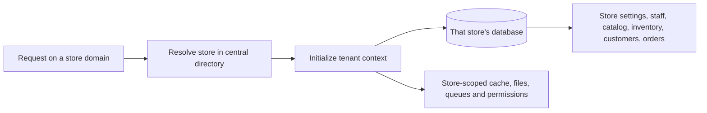
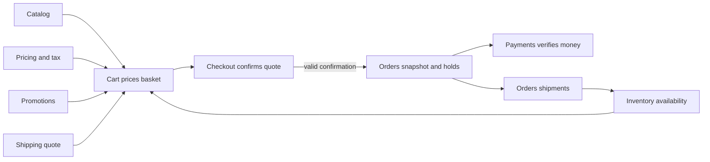

# Tenant: one merchant's store

This guide explains the tenant side of Sellora. A **tenant** is one complete
merchant store: its own settings, team, products, inventory, shoppers, orders
and payment configuration. Each store's business data is held in its own
tenant database.

## Start with this distinction

| If you are asking… | Look in… |
| --- | --- |
| How does a store sign up, get its domain/database, or get suspended by Sellora? | [Landlord documentation](../landlord/README.md) |
| How does one store sell a product to a shopper? | The tenant guides below |
| Who can change product prices, fulfill orders or manage staff in a store? | Tenant Identity and the relevant business domain |
| How does a feature become available on a particular store's plan? | [Landlord plans and subscriptions](../landlord/plans-and-subscriptions.md) |

## How a store request reaches its data

The API does not pick a store based on a client-supplied `tenant_id`. It
identifies the store from its domain, then initializes the tenant context
before tenant routes run. Tenant-aware services are scoped so one store's
data, cache and permissions do not become another store's.

## A shopper's purchase, from start to finish

1. Staff prepare and publish products in [Catalog](catalog.md), set stock
   rules/quantities in [Inventory](inventory.md), and configure prices and
   taxes in [Pricing](pricing.md).
2. The shopper optionally signs in through [Customers](customers.md), then
   browses and adds exact variants to a [Cart](cart.md).
3. Cart displays current availability, a current price and tax calculation,
   eligible discounts and shipping options. It does not reserve stock or
   guarantee that the current quote will still be valid later.
4. [Checkout](checkout.md) collects contact, delivery, payment and consent
   choices and produces a short-lived quote. When the shopper confirms,
   Checkout checks the quote and cart version again.
5. A valid confirmation reserves stock and limited promotion uses, creates
   the [Order](orders.md) and its payment holds, and clears the cart. If the
   quote changed, the shopper must review the new price instead.
6. [Payments](payments.md) confirms online or staff-recorded payment.
   [Shipping](shipping.md) determines what the shopper selected;
   Orders creates shipments and advances their fulfillment.
7. [Delivery](delivery.md) currently supports driver sign-in only; it does
   not yet assign shipments. [Messaging](messaging.md) is also not yet a
   central tenant domain.

For the action-by-action end-to-end map, read
[Sellora business flows](business-flows.md).

## Tenant guides

- [Cart](cart.md)
- [Catalog](catalog.md)
- [Checkout](checkout.md)
- [Customers](customers.md)
- [Delivery](delivery.md)
- [Identity](identity.md)
- [Inventory](inventory.md)
- [Messaging](messaging.md)
- [Orders](orders.md)
- [Payments](payments.md)
- [Payment gateway integrations](payment-gateways.md)
- [Pricing](pricing.md)
- [Promotions](promotions.md)
- [Settings](settings.md)
- [Shipping](shipping.md)

For local requests to this store's domain, use the
[tenant API testing guide](api-testing.md). The
[landlord API testing guide](../landlord/api-testing.md) covers platform and
registration endpoints on the central domain.
